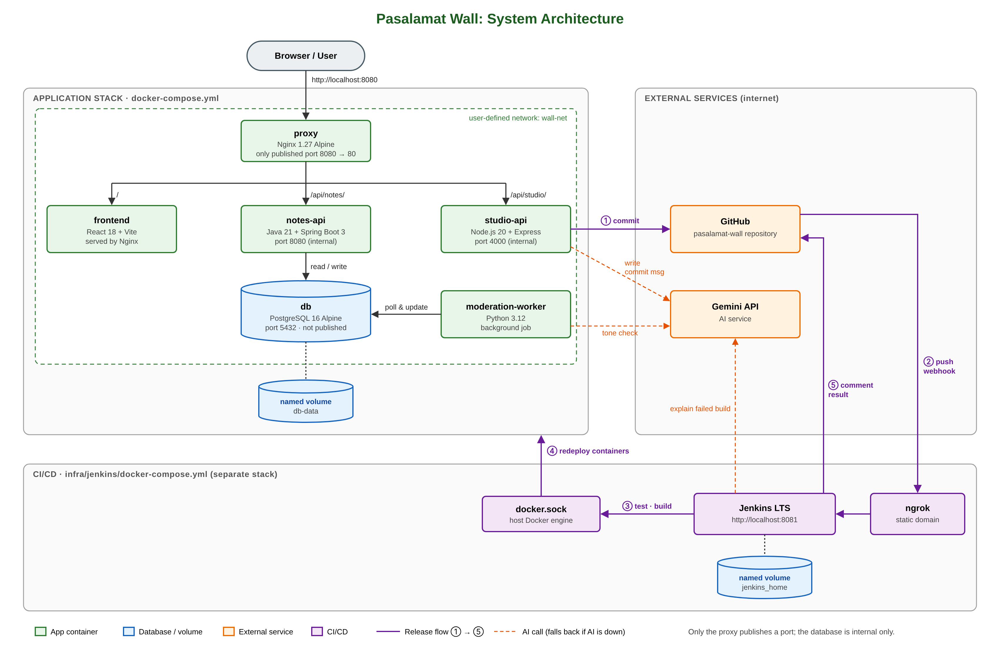

# Pasalamat Wall

**An AI-assisted, self-shipping gratitude board with a browser-to-pipeline Release Studio.**

Students post short thank-you notes to classmates, teachers, guards, and canteen staff. A moderation worker screens every note with a word filter and Gemini AI before it appears on the wall. The **Release Studio** lets the site's content be edited in the browser and committed straight to GitHub with an AI-written commit message. Every commit triggers a **Jenkins** pipeline that tests, builds, deploys, and comments the result back on the commit.

> ITE - 304 · System Architecture and Integration · Final Project
> Group **Solo Leveling** · Sugay, Anferl Lee T.

---

## Contents

- [Architecture](#architecture)
- [Modules](#modules)
- [Repository structure](#repository-structure)
- [Prerequisites](#prerequisites)
- [Run the application stack](#run-the-application-stack)
- [Start Jenkins](#start-jenkins)
- [Trigger configuration (webhook + polling)](#trigger-configuration-webhook--polling)
- [The pipeline](#the-pipeline)
- [Quality gate, persistence, and rollback](#quality-gate-persistence-and-rollback)
- [Team and roles](#team-and-roles)

---

## Architecture



- **One entry point.** Only the Nginx proxy publishes a port (`8080 → 80`). Every other container is private.
- **Two networks.** `wall-frontend` connects the proxy to the services; `wall-backend` connects only the services that need the database. The proxy and studio-api cannot reach PostgreSQL.
- **Persistent data.** PostgreSQL stores its data in the named volume `pasalamat-db-data`, so notes survive restarts and redeploys.
- **Separate CI/CD stack.** Jenkins runs in its own Compose project (`infra/jenkins/`) and controls the app through the host's Docker socket.

**Release flow:** Release Studio → commit to GitHub → webhook through ngrok → Jenkins tests and builds → redeploys → comments ✅/❌ on the commit.

---

## Modules

| Container | Technology | Responsibility |
| --- | --- | --- |
| `proxy` | Nginx 1.27 (unprivileged, Alpine) | Single entry point; routes `/`, `/api/notes`, `/api/studio`, `/health/*`, `/adminer/` |
| `frontend` | React 18 + Vite, served by Nginx | Gratitude wall, post-a-note form, hearts, Release Studio; shows the build number in the footer |
| `notes-api` | Java 21, Spring Boot 4, Spring Data JPA, Flyway | Creates and lists notes, records hearts, owns the database schema |
| `moderation-worker` | Python 3.12, psycopg 3, Gemini API | Approves or flags pending notes (word filter + AI tone check, with fallback) |
| `studio-api` | Node.js 20 + Express, GitHub REST API, Gemini API | Release Studio backend: login, validation, AI commit messages, commits to GitHub |
| `db` | PostgreSQL 16.4 (Alpine) | Tables `notes`, `reactions`, `moderation_log`; port not published |
| `adminer` | Adminer 4.8.1 | Database viewer at `/adminer/` (still requires the database password) |

---

## Repository structure

```
pasalamat-wall/
├── Jenkinsfile               # main pipeline (pipeline as code)
├── docker-compose.yml        # application stack
├── .env.example              # placeholder values; the real .env is never committed
├── ci/
│   ├── Jenkinsfile.rollback  # parameterized rollback job
│   └── notify.py             # posts build results (+ Gemini explanation) on GitHub commits
├── docs/
│   └── architecture.png
├── proxy/                    # Nginx reverse proxy
├── frontend/                 # React app (src/site.json = content edited by the Release Studio)
├── notes-api/                # Spring Boot API + Flyway migrations (db/migration)
├── studio-api/               # Release Studio backend
├── moderation-worker/        # Python moderation worker
└── infra/jenkins/            # Jenkins image + its own docker-compose.yml
```

---

## Prerequisites

- **Docker Desktop** (WSL 2 enabled on Windows) or Docker Engine with the Compose plugin; at least 8 GB RAM
- **Git**
- **ngrok** account (free) for the GitHub webhook
- A **GitHub personal access token** (classic, `public_repo` scope only)
- A **Gemini API key** (optional: without it, the app falls back to non-AI behavior)

Check your setup:

```bash
docker version
docker compose version
git --version
```

---

## Run the application stack

**1. Create your `.env`** from the template and fill in real values:

```bash
cp .env.example .env        # PowerShell: Copy-Item .env.example .env
```

| Variable | Purpose |
| --- | --- |
| `POSTGRES_PASSWORD` | Database password |
| `STUDIO_PASSWORD` | Release Studio login password |
| `STUDIO_SECRET` | Long random string used to sign login tokens |
| `GITHUB_TOKEN` | Lets studio-api commit `site.json` |
| `GEMINI_API_KEY` | AI moderation and commit messages (optional) |

**2. Start everything with one command:**

```bash
docker compose up -d --build
docker compose ps           # wait until every service is (healthy)
```

**3. Open the app:**

| URL | What |
| --- | --- |
| http://localhost:8080 | Gratitude wall |
| http://localhost:8080/#/studio | Release Studio |
| http://localhost:8080/adminer/ | Database viewer (server `db`) |
| http://localhost:8080/health/notes | Health endpoints: also `/health`, `/health/studio`, `/health/worker` |

> **Running Compose by hand after Jenkins has deployed?** Set the build number first, or Compose uses `TAG=latest` from `.env`:
> `export TAG=<build number>` (PowerShell: `$env:TAG = "<build number>"`), then `docker compose up -d --wait`.

---

## Start Jenkins

Jenkins lives in its own Compose project, so redeploying the app never restarts Jenkins.

```bash
cd infra/jenkins
docker compose up -d --build
docker exec jenkins cat /var/jenkins_home/secrets/initialAdminPassword
docker exec jenkins docker ps      # proves Jenkins can control Docker
```

1. Open **http://localhost:8081**, unlock Jenkins, install the suggested plugins, and create an admin user. The image already pre-installs the Pipeline, Git, GitHub, Credentials Binding, Stage View, Docker Pipeline, and Timestamper plugins.
2. **Manage Jenkins → Credentials → Global**: add three credentials:

   | ID | Kind | Value |
   | --- | --- | --- |
   | `pasalamat-env` | Secret file | Your production `.env` |
   | `github-token` | Secret text | GitHub token (for build comments) |
   | `gemini-api-key` | Secret text | Gemini key (for failure explanations) |

3. **New Item → `pasalamat-wall` → Pipeline**
   - Triggers: ☑ *GitHub hook trigger for GITScm polling*
   - Pipeline script from SCM → Git → `https://github.com/anferlleesugay/pasalamat-wall.git`
   - Branch `*/main` · Script Path `Jenkinsfile`
4. **New Item → `pasalamat-rollback` → Pipeline**: same repository, Script Path `ci/Jenkinsfile.rollback`, no triggers.
5. Click **Build Now** once on each job so Jenkins registers the triggers and the rollback parameter.

> **Security note.** Mounting the Docker socket and running Jenkins as root is acceptable for a lab, not for production. Safer options: dedicated build agents, rootless Docker, Docker-in-Docker with TLS, or Kaniko.

---

## Trigger configuration (webhook + polling)

**Primary: GitHub webhook (instant).**

```bash
ngrok config add-authtoken <your-authtoken>
ngrok http 8081
```

Copy the `https://….ngrok-free.app` address, then in GitHub go to **Settings → Webhooks → Add webhook**:

- Payload URL: `https://<ngrok-address>/github-webhook/` (keep the trailing slash)
- Content type: `application/json`
- Events: **Just the push event**

The ping should show **200** under *Recent Deliveries*. If the ngrok address changes after a restart, update the Payload URL.

**Fallback: Poll SCM.** The Jenkinsfile also declares `pollSCM('H/2 * * * *')`, so a push is still built within about 2 minutes if the tunnel is down.

---

## The pipeline

```
Checkout → Test ─┬─ notes-api · JUnit          ┐
                 ├─ studio-api · Jest          │ parallel, each runs
                 ├─ moderation-worker · pytest │ docker build --target test
                 └─ frontend · Vitest          ┘
         → Build Images  (tagged :<build number> and :<short commit>)
         → Deploy        (docker compose up -d --no-build --wait)
         → Smoke Test    (health endpoints + version.json shows this build)
 post    → archive logs · comment ✅/❌ on the GitHub commit (Gemini explains failures)
```

| Stage | If it fails |
| --- | --- |
| Test | Build, Deploy, and Smoke Test are skipped; the live site keeps the previous version |
| Build Images | Nothing is deployed |
| Deploy | Fails unless every container becomes healthy |
| Smoke Test | The build is marked failed, so a deploy that didn't really go live is never reported green |

**Tests:** 76 automated tests run on every push (studio-api 36 · moderation-worker 20 · notes-api 12 · frontend 8), plus the curl smoke tests. GitHub, Gemini, and the database are mocked, so tests are fast, free, and repeatable.

---

## Quality gate, persistence, and rollback

**Quality gate.** In the Release Studio, set the theme color to `#zzz`, tick **Skip validation (quality-gate demo)**, and ship. `frontend/src/siteRules.test.js` checks the real `site.json`, so the Test stage fails, Deploy is skipped, the site stays on the previous build, and Jenkins comments ❌ with Gemini's explanation on the commit.

**Persistence.**

```bash
docker compose down        # removes containers, keeps the named volume
docker compose up -d --wait
```

Notes posted before the restart are still on the wall. Never use `down -v`, which deletes the volume.

**Rollback.** Every image is tagged with its build number. Run **pasalamat-rollback → Build with Parameters → `ROLLBACK_TAG`** (leave it empty to list available versions). The same rollback by hand:

```bash
export TAG=4               # PowerShell: $env:TAG = "4"
docker compose up -d --no-build --wait
```

The footer shows the build number that is live.

---

## Team and roles

| Role | Member |
| --- | --- |
| Project Lead / Scrum Master | Sugay, Anferl Lee T. |
| DevOps / CI-CD Engineer | Sugay, Anferl Lee T. |
| Infrastructure Engineer | Sugay, Anferl Lee T. |
| Backend and Database Engineer | Sugay, Anferl Lee T. |
| Frontend, QA, and Documentation Lead | Sugay, Anferl Lee T. |

Solo project: one member holds all five roles.
